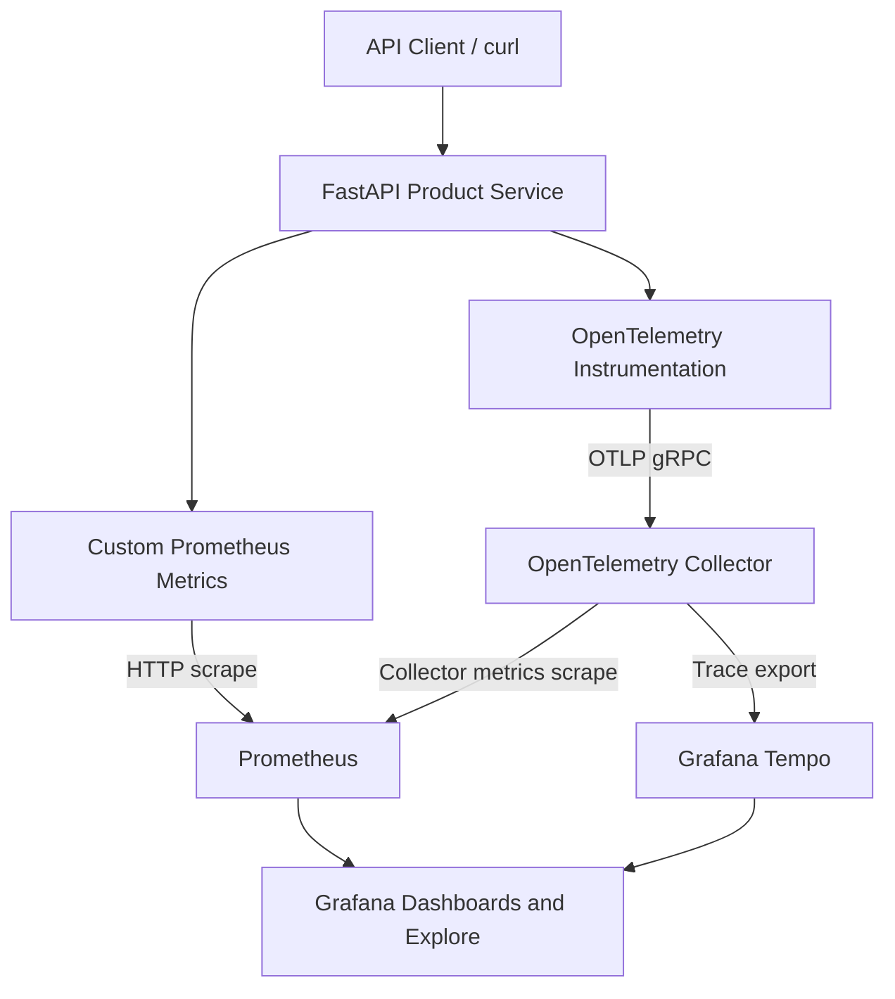
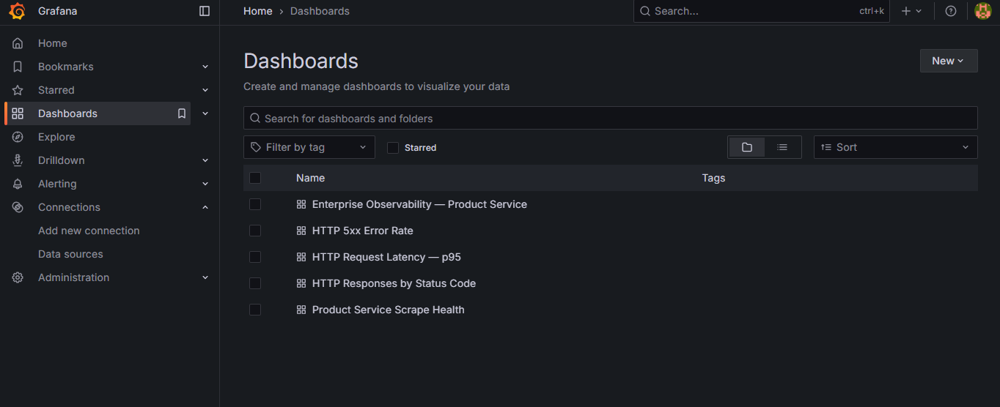
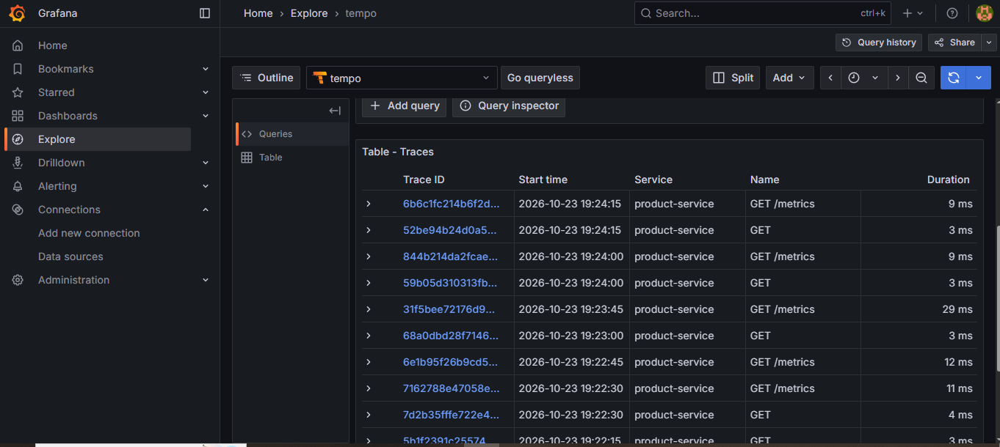
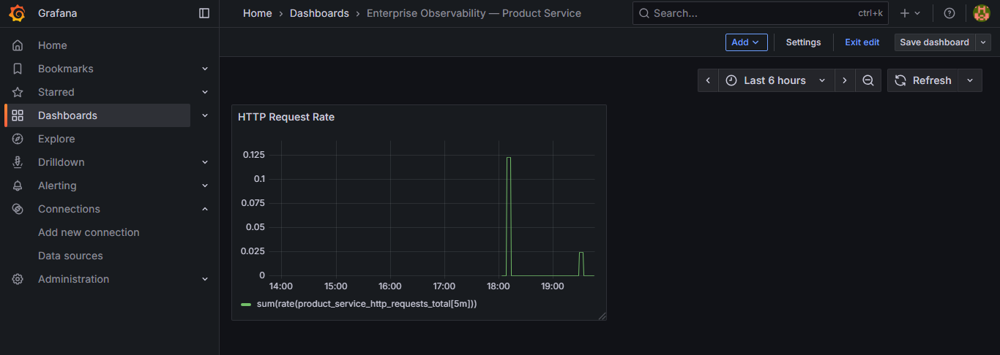
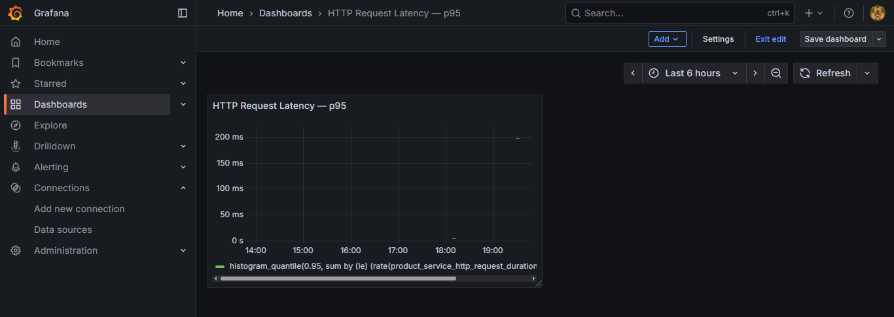
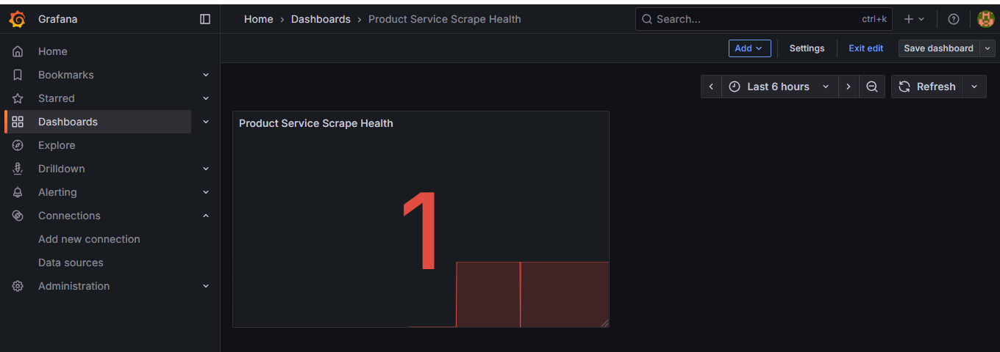

# Enterprise Observability Stack with Distributed Tracing

A containerized observability platform demonstrating application metrics, distributed tracing, service health monitoring, and dashboard-driven troubleshooting using Prometheus, Grafana, OpenTelemetry, and Grafana Tempo.

## Project Overview

Modern distributed applications require more than application logs. Engineering teams need visibility into request volume, latency, HTTP errors, service availability, and request execution paths.

This project implements a local observability environment for a Python FastAPI Product Service. It collects application metrics, exports OpenTelemetry traces, stores time-series data, and presents operational insights through Grafana dashboards.

### Business Scenario

An engineering team needs to investigate slow API requests, identify HTTP failures, monitor service health, and trace requests through an instrumented application.

This project demonstrates how an engineer can build the foundation for that workflow using open-source observability tooling.

### Key Capabilities

- **Application instrumentation:** FastAPI request instrumentation and custom Prometheus metrics.
- **Distributed tracing:** OpenTelemetry instrumentation and OTLP trace export.
- **Metrics collection:** Prometheus scraping application and collector metrics.
- **Operational dashboards:** Grafana visualizations for request rate, status codes, p95 latency, error rate, and service health.
- **Trace investigation:** Search for traces and inspect individual trace timelines in Tempo.
- **Health checks:** Application health and readiness endpoints.
- **Reproducible deployment:** Docker Compose-based multi-service environment.
- **Technical evidence:** Screenshots documenting the working application and observability stack.

## Architecture



### Component Responsibilities

| Component | Responsibility |
|---|---|
| Product Service | FastAPI application exposing product endpoints, health checks, and metrics |
| OpenTelemetry instrumentation | Captures application request traces |
| OpenTelemetry Collector | Receives and exports telemetry |
| Prometheus | Scrapes and stores time-series metrics |
| Grafana Tempo | Stores and serves distributed traces |
| Grafana | Provides dashboards and trace exploration |
| Docker Compose | Runs and connects the services |

The current implementation is a local lab. It demonstrates core observability workflows but is not a production or multi-region deployment.

## Technology Stack

- Python and FastAPI
- Docker and Docker Compose
- OpenTelemetry Python instrumentation
- OpenTelemetry Collector Contrib
- Prometheus
- Grafana
- Grafana Tempo
- PromQL
- Linux / Ubuntu / WSL

## Repository Structure

```text
enterprise-observability/
├── app/
│   ├── product-service/
│   │   ├── Dockerfile
│   │   └── main.py
│   └── requirements.txt
├── observability/
│   ├── otel/
│   │   └── collector.yaml
│   ├── prometheus/
│   │   └── prometheus.yml
│   └── tempo/
│       └── tempo.yaml
├── docs/
│   ├── architecture/
│   │   └── architecture.md
│   ├── evidence/
│   │   ├── README.md
│   │   ├── application-metrics.png
│   │   ├── grafana-dashboard.png
│   │   ├── health-check.png
│   │   ├── prometheus-targets.png
│   │   └── tempo-trace.png
│   └── runbooks/
│       └── incident-response.md
├── .env.example
├── .gitignore
├── docker-compose.yml
└── README.md
```

## Prerequisites

Install or configure:

- Docker Engine with Docker Compose support
- Git
- `curl`
- A web browser

Verify Docker is available:

```bash
docker --version
docker compose version
docker info
```

If Docker commands require elevated privileges in your environment, configure Docker access appropriately rather than assuming the current shell has permission.

## Deployment Guide

### 1. Obtain the repository

If you have already cloned the repository, enter its directory:

```bash
cd ~/enterprise-observability
```

For a fresh installation, clone your GitHub repository and enter the cloned directory.

### 2. Review environment configuration

Inspect the example environment file:

```bash
cat .env.example
```

If the Compose configuration expects a local `.env` file, create it from the example and set appropriate local values:

```bash
cp .env.example .env
```

Only do this if `.env` does not already exist, so you do not overwrite existing local configuration.

Never commit `.env` or real credentials. Review `.gitignore` before staging files.

### 3. Validate the Compose configuration

```bash
docker compose config --quiet
```

A successful exit indicates that Compose accepted the configuration. This does not by itself prove that every container can start.

### 4. Build and start the stack

```bash
docker compose up -d --build
```

Inspect container status:

```bash
docker compose ps
```

Review service logs:

```bash
docker compose logs --tail=100
```

If a service fails to start, inspect its logs before proceeding.

### 5. Verify the Product Service

Health endpoint:

```bash
curl -fsS http://127.0.0.1:8001/health
```

Expected response:

```json
{"status":"healthy","service":"product-service"}
```

Readiness endpoint:

```bash
curl -i http://127.0.0.1:8001/ready
```

Inspect an existing product:

```bash
curl -i http://127.0.0.1:8001/products/101
```

Test a missing product:

```bash
curl -i http://127.0.0.1:8001/products/999
```

The missing product should return HTTP 404. This is useful for testing error metrics.

### 6. Open the observability interfaces

| Service | Local URL | Purpose |
|---|---|---|
| Product Service | http://127.0.0.1:8001 | Application API |
| Prometheus | http://127.0.0.1:9090 | Metrics and PromQL |
| Grafana | http://127.0.0.1:3000 | Dashboards and Explore |
| Tempo | http://127.0.0.1:3200 | Local Tempo API |

The OpenTelemetry Collector also receives OTLP traffic on ports 4317 (gRPC) and 4318 (HTTP) where configured. These are telemetry ingestion endpoints, not browser dashboards.

Use the Grafana credentials configured for your local environment. Do not rely on a sample or default password for a shared or production deployment.

## Metrics and Instrumentation

The Product Service exposes a Prometheus-compatible metrics endpoint at:

`http://127.0.0.1:8001/metrics/`

Inspect the metrics:

```bash
curl -fsS http://127.0.0.1:8001/metrics/
```

The application includes custom metrics for HTTP traffic:

- `product_service_http_requests_total` — request count by HTTP method, endpoint, and status code.
- `product_service_http_request_duration_seconds` — request duration histogram by method and endpoint.

The application middleware excludes `/metrics` from its custom application traffic counters to avoid counting metric scrapes as ordinary application requests.

Prometheus is also configured to scrape its own metrics, the OpenTelemetry Collector metrics endpoint, and the Product Service.

### Generate Test Traffic

Run a small test workload:

```bash
for i in 1 2 3 4 5; do
  curl -s -o /dev/null -w "HTTP %{http_code}\n" \
    http://127.0.0.1:8001/products/101
done

for i in 1 2; do
  curl -s -o /dev/null -w "HTTP %{http_code}\n" \
    http://127.0.0.1:8001/products/999
done
```

This generates successful product lookups and expected 404 responses. These requests provide sample traffic for dashboards and trace exploration.

### Useful PromQL Queries

**Request rate**

```promql
sum(rate(product_service_http_requests_total[5m]))
```

**Responses grouped by HTTP status**

```promql
sum by (status_code) (product_service_http_requests_total)
```

**p95 request duration**

```promql
histogram_quantile(
  0.95,
  sum by (le) (
    rate(product_service_http_request_duration_seconds_bucket[5m])
  )
)
```

**HTTP 5xx error rate as a percentage of requests**

```promql
100 *
sum(rate(product_service_http_requests_total{status_code=~"5.."}[5m]))
/
clamp_min(sum(rate(product_service_http_requests_total[5m])), 1e-9)
```

**Product Service scrape health**

```promql
up{job="product-service"}
```

A value of `1` indicates that Prometheus can scrape the target successfully; `0` indicates a failed scrape.

The error-rate expression measures 5xx responses only. Expected 404 responses are not counted as server errors.

## Grafana Dashboard

The dashboard is named **Enterprise Observability — Product Service** and contains five panels:

| Panel | What it demonstrates |
|---|---|
| HTTP Request Rate | Incoming request activity |
| HTTP Responses by Status Code | Distribution of observed HTTP responses |
| p95 Latency | Estimated 95th-percentile request duration from the histogram |
| HTTP 5xx Error Rate | Percentage of observed requests returning 5xx responses |
| Product Service Scrape Health | Prometheus target availability |

The Prometheus and Tempo data sources have been configured and their Save & Test checks succeeded.

## Distributed Tracing

The Product Service uses OpenTelemetry instrumentation and exports traces through the OpenTelemetry Collector to Tempo.

### Trace Verification Workflow

1. Generate requests to `/products/101` and `/products/999`.
2. Open Grafana.
3. Navigate to **Explore** and select Tempo.
4. Search for traces associated with `product-service`.
5. Open an individual trace.
6. Inspect the trace ID, timeline, span durations, and available span attributes.
7. Compare traces from successful requests with traces from missing-product requests where the captured information permits.

**Verified milestone:** Trace search returns Product Service traces, and individual traces can be opened in Grafana to inspect their span timelines.

The exact span names and attributes depend on the instrumentation and application code. Do not assume a custom span such as `product.lookup` exists unless it is visible in the captured trace.

## Evidence Gallery

Screenshots from the running local environment are stored in [`docs/evidence/`](docs/evidence/).

### Grafana Dashboard



### Tempo Distributed Trace



### Prometheus Targets



### Application Metrics



### Application Health Check



These screenshots document the observed local lab. They are not evidence of a production service-level agreement or production-scale load test.

## Troubleshooting

### A container is not running

```bash
docker compose ps
docker compose logs --tail=150
```

Inspect the logs for the failing service and correct the underlying configuration before restarting it.

### A host port is already in use

Check the relevant host port. For example:

```bash
ss -ltnp | grep -E ':(8001|3000|3200|4317|4318|9090)\b'
```

The Product Service is mapped to host port `8001` because host port `8000` was already allocated in the development environment. Do not change the mapping without checking the Compose configuration and dependent URLs.

### A Prometheus target is down

1. Open the Prometheus targets page.
2. Identify the failed target and its reported error.
3. Check that the corresponding container is running.
4. Review service logs.
5. Verify that the target address uses the Compose service name and container port where appropriate.

### Metrics are missing

- Generate new requests to the Product Service.
- Confirm the metrics endpoint responds.
- Inspect `observability/prometheus/prometheus.yml`.
- Check the Product Service target in Prometheus.
- Confirm that the queried metric name and labels match the exported metrics.

### Traces are missing

- Generate new application requests.
- Inspect Product Service logs.
- Check the OpenTelemetry Collector logs.
- Verify OTLP exporter and receiver configuration.
- Confirm that Tempo is running and accessible from the Grafana/Compose network.
- Search using the correct service name and a suitable time range.

### Grafana has no data

- Confirm the Prometheus and Tempo data sources use the correct internal service addresses.
- Check the selected dashboard time range.
- Verify that Prometheus has scraped recent samples.
- Generate new requests and repeat the query.

## Operational Runbook

A basic incident investigation can follow this sequence:

1. **Detect:** Check the dashboard for increased latency, error rates, or a failed scrape.
2. **Scope:** Use response codes and request-rate metrics to understand the affected workload.
3. **Investigate:** Open representative traces in Grafana Explore.
4. **Correlate:** Compare span timing and available attributes with application logs.
5. **Recover:** Apply a justified fix and verify health, metrics, and traces.
6. **Document:** Record the symptom, root cause, remediation, and follow-up action.

See [`docs/runbooks/incident-response.md`](docs/runbooks/incident-response.md) for the project runbook.

## Security Considerations

This project is intended for local development and demonstration.

- Bind published service ports to loopback where appropriate.
- Do not commit `.env` files, passwords, tokens, or other secrets.
- Replace development credentials before using the stack in any shared environment.
- Restrict access to telemetry endpoints and observability interfaces.
- Review sensitive data in span attributes and logs before exporting telemetry.
- Use appropriate authentication, TLS, network controls, secret management, and access policies for a production deployment.
- Establish retention, backup, and access-control policies before storing operational telemetry from real systems.

## Current Scope and Limitations

Implemented and verified:

- Containerized Product Service and observability components.
- Application health and readiness endpoints.
- Custom Prometheus request counters and duration histogram.
- Prometheus target scraping and query execution.
- Five-panel Grafana dashboard.
- OpenTelemetry trace delivery to Tempo.
- Individual trace timeline inspection in Grafana.
- Screenshots documenting the local implementation.

Not yet claimed as implemented:

- Multi-cluster or multi-region observability.
- Production high availability for Prometheus, Grafana, Tempo, or the Collector.
- Long-term object-storage-backed trace retention.
- Production authentication and TLS across all components.
- Alert delivery to an incident-management platform.
- Automated CI/CD deployment of this observability stack.
- Formal load testing, capacity planning, or validated production SLOs.

## Potential Enhancements

- Provision Grafana data sources and dashboards from version-controlled files.
- Add alert rules for elevated 5xx rates, latency, and scrape failures.
- Add structured log collection and trace/log correlation.
- Introduce load testing with a repeatable workload and documented results.
- Add CI validation for configuration, application tests, and container builds.
- Evaluate secure remote access, durable storage, and high availability for a production-oriented deployment.

## Engineering Skills Demonstrated

- Containerization and service orchestration
- Python API instrumentation
- Prometheus metrics and PromQL
- OpenTelemetry trace instrumentation and export
- Distributed trace investigation
- Grafana dashboard development
- Health checks and operational troubleshooting
- Technical documentation and evidence collection

## License

Add a license file if you intend to distribute this project as open source. Do not imply a license has been granted until the repository includes one.
