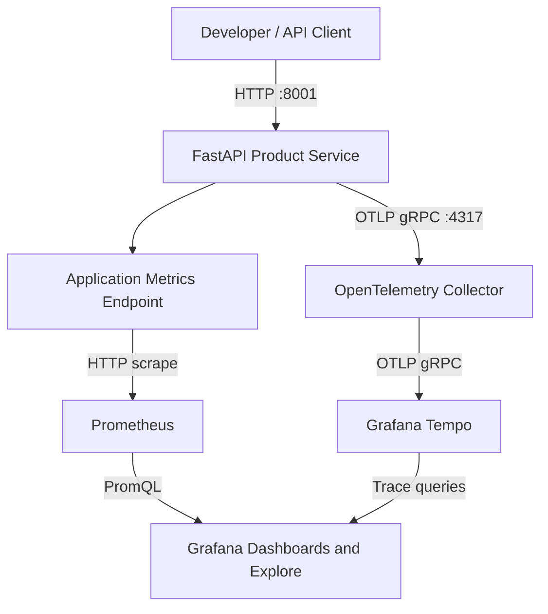

# Enterprise Observability Architecture

## 1. Purpose

This project implements a containerized observability stack for a sample
FastAPI Product Service. It demonstrates application health monitoring,
Prometheus metrics, distributed tracing with OpenTelemetry, trace storage
with Grafana Tempo, and dashboard-driven troubleshooting with Grafana.

**Deployment scope:** This is a local portfolio lab, not a production
high-availability deployment.

## 2. Architecture Diagram

## 3. Components and Responsibilities

| Component | Responsibility |
|---|---|
| FastAPI Product Service | Exposes product endpoints, health checks, readiness checks, and application metrics |
| OpenTelemetry instrumentation | Captures application request traces |
| OpenTelemetry Collector | Receives OTLP telemetry and exports traces to Tempo |
| Prometheus | Scrapes and stores time-series metrics |
| Grafana Tempo | Stores and serves distributed traces |
| Grafana | Presents metrics dashboards and supports trace exploration |
| Docker Compose | Runs and connects the services on a local Docker network |

## 4. Telemetry Flow

### Metrics

1. A client sends requests to the Product Service.
2. The application exposes request counters and request-duration histograms.
3. Prometheus scrapes the application's metrics endpoint.
4. Prometheus evaluates queries for request rate, HTTP 5xx error rate,
   p95 latency, and request rate by endpoint.
5. Grafana displays the resulting time series on the Product Service dashboard.

### Distributed traces

1. Instrumented application requests generate trace data.
2. The application exports traces using OTLP.
3. The OpenTelemetry Collector receives and processes the telemetry.
4. The Collector exports traces to Grafana Tempo.
5. Grafana queries Tempo so engineers can inspect trace timelines and spans.

## 5. Local Endpoints

| Service | Local endpoint |
|---|---|
| Product Service | http://127.0.0.1:8001 |
| Health check | http://127.0.0.1:8001/health |
| Readiness check | http://127.0.0.1:8001/ready |
| Application metrics | http://127.0.0.1:8001/metrics/ |
| Prometheus | http://127.0.0.1:9090 |
| Prometheus targets | http://127.0.0.1:9090/targets |
| Grafana | http://127.0.0.1:3000 |
| Tempo HTTP API | http://127.0.0.1:3200 |
| OTLP gRPC receiver | 127.0.0.1:4317 |
| OTLP HTTP receiver | 127.0.0.1:4318 |

The published service ports are bound to loopback for local access.
The OTLP receiver ports are used by telemetry-producing applications and
tools. Internal service-to-service communication uses the Docker network.

## 6. Reliability and Security Considerations

- Separate health and readiness endpoints support basic service checks.
- Prometheus metrics help identify request failures and latency changes.
- Distributed traces support request-level troubleshooting.
- Docker named volumes preserve configured telemetry and Grafana data
  across container recreation.
- Configuration files are mounted read-only where configured.
- The Grafana administrator password is supplied through the local `.env`
  file and should not be committed to source control.
- `.env`, virtual environments, Python caches, and local backup files are
  excluded from version control through `.gitignore`.
- The CI workflow runs application tests, dependency auditing, Compose
  validation, and container vulnerability scanning.

## 7. Current Scope and Limitations

This implementation is a single-host lab. It does not provide:

- Multi-region failover or high availability.
- Redundant OpenTelemetry Collectors.
- Production authentication and TLS across all interfaces.
- Centralized long-term object storage.
- Configured alert delivery and on-call integration.
- Production-scale load testing or validated service-level objectives.
- A tested production backup and disaster recovery strategy.

Tempo uses local storage with a configured 24-hour block retention period.
Local persistence alone is not a substitute for tested backups or disaster
recovery procedures.

## 8. Suggested Production Evolution

1. Deploy redundant collectors and monitoring components.
2. Configure authenticated access and TLS.
3. Introduce durable object storage and documented retention policies.
4. Define service-level indicators, objectives, and alerting rules.
5. Add load testing, capacity planning, and controlled failure-injection tests.
6. Automate deployment and validation through CI/CD.
7. Test backup restoration and document recovery procedures.
8. Establish operational ownership, escalation paths, and incident reviews.
